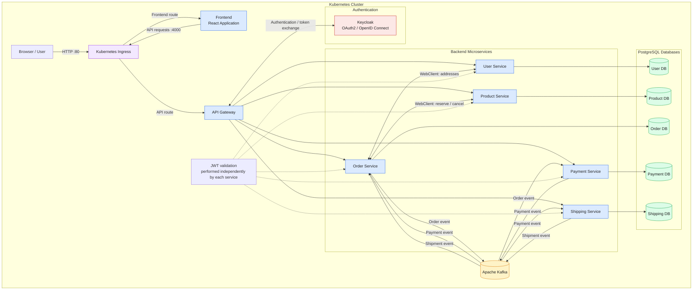

# Online Shop — Kubernetes Deployment

Kubernetes configuration repository for deploying the Online Shop microservices application and its supporting infrastructure.

This repository contains Kubernetes manifests for the frontend, backend microservices, PostgreSQL databases, Kafka, and Keycloak. It also organizes deployment configuration using Kustomize.

## Architecture

The deployment includes the following components:

- **Frontend** — Web application entry point.
- **API Gateway** — Routes requests to backend microservices.
- **Backend services** — Order, payment, product, shipping, and user services.
- **PostgreSQL** — Separate database resources for individual services, including Keycloak.
- **Apache Kafka** — Event-based communication between backend services.
- **Keycloak** — Identity and access management using OAuth 2.0 and OpenID Connect.

### Architecture Diagram



## Repository Structure

```text
online-shop-k8s/
├── base/
│   ├── db/
│   │   ├── keycloak-db/
│   │   ├── order-service-db/
│   │   ├── payment-service-db/
│   │   ├── product-service-db/
│   │   ├── shipping-service-db/
│   │   └── user-service-db/
│   ├── frontend/
│   │   ├── config.yaml
│   │   ├── deployment.yaml
│   │   ├── kustomization.yaml
│   │   └── service.yaml
│   ├── infrastructure/
│   │   ├── portshop-kafka/
│   │   └── portshop-keycloak/
│   ├── service/
│   │   ├── api-gateway/
│   │   ├── order-service/
│   │   ├── payment-service/
│   │   ├── product-service/
│   │   ├── shipping-service/
│   │   └── user-service/
│   └── kustomization.yaml
├── overlays/
├── .gitignore
├── cookies.txt
└── LICENSE
```

### Directory Responsibilities

| Directory | Purpose |
|---|---|
| `base/` | Shared Kubernetes resource definitions |
| `base/frontend/` | Frontend deployment, service, and configuration |
| `base/service/` | Kubernetes resources for backend microservices |
| `base/db/` | Database-related Kubernetes resources |
| `base/infrastructure/` | Supporting infrastructure such as Kafka and Keycloak |
| `overlays/` | Environment-specific customizations, if configured |
| `kube-setups/` | Kubernetes setup scripts or configuration files |
| `LICENSE` | Project license |

Each component's `kustomization.yaml` specifies the resources and customizations included in that Kustomize build.

## Technology Stack

- Kubernetes
- Kustomize
- PostgreSQL
- Apache Kafka
- Keycloak
- React frontend and Spring Boot microservices, if applicable to the deployed application

## Prerequisites

Before deploying, ensure you have:

- A running Kubernetes cluster. Minikube is used for example.
- `kubectl` installed and configured for the target cluster.
- A container registry accessible by the cluster.
- Container images built and published for the frontend and backend services.
- Required configuration values, database credentials, and authentication settings.
- Sufficient cluster resources for the application and its infrastructure.

If there is no existing cluster, create minikube container for local test:

### 1. Run minikube

```bash
minikube start
```

### 2. Enable ingress

```bash
minikube addons enable ingress
```

verify ingress status:

```bash
kubectl get pods -n ingress-nginx
```

### 3. Load microservices and frontend images into your cluster

```bash
minikube image load portshop/xxx-service:version
```

Check your Kubernetes connection:

```bash
kubectl cluster-info
kubectl get nodes
```

Check the installed client version:

```bash
kubectl version --client
kubectl kustomize --help
```

## Deployment

### 1. Clone the Repository

```bash
git clone https://github.com/yutojama/online-shop-k8s.git
cd online-shop-k8s
```

### 2. Review the Configuration

Before deploying, review the Kubernetes manifests and confirm:

- Container image names and tags.
- Namespace configuration.
- Service names, ports, and selectors.
- Database connection settings.
- Kafka bootstrap and topic configuration.
- Keycloak realm, client, and issuer settings.
- Persistent storage requirements.
- Secret references and environment variables.

Ensure the target cluster can pull the required container images.

### 3. Validate the Kustomize Configuration

Build the root Kustomize configuration:

```bash
kubectl kustomize base/
```

This renders the resources without applying them to the cluster:

```bash
kubectl kustomize overlays/<environment>/
```

Replace `<environment>` with an actual directory in `overlays/`.

### 4. Deploy to Kubernetes

```bash
kubectl apply -k overlays/<environment>/
```

### 5. Verify the Deployment

Check the deployed resources:

```bash
kubectl get namespaces
kubectl get deployments --all-namespaces
kubectl get services --all-namespaces
kubectl get pods --all-namespaces
```

In the online-shop project, all elements are set up with the default namespace.

### 6. Load database docker volumes and images into your cluster:

Mount docker volumes if your volumes are centralized in a folder:

```bash
minikube mount "C:\...\images:/mnt/portshop-images"
```

Mount product image folder:

```bash
minikube mount "C:\...\db_volumes:/mnt/portshop-database"
```

Some minikube versions make use of 9p file system, which results in recursive directory error while reading from database volume.
Therefore, it will be recommended to load these folders into minikube:

```bash
sudo tar -C /mnt/portshop-images -cf - . | sudo tar -C /var/lib/portshop-images -xf -
```

```bash
sudo tar -C /mnt/portshop-database -cf - . | sudo tar -C /var/lib/portshop-database -xf -
```

In database pv.yaml, put these paths under hostPath:

hostPath:
    path: /var/lib/portshop-database/product-service-db
    type: Directory

## Configuration and Secrets

Configuration should be separated from sensitive credentials. The Kubernetes Secrets is not implemented at present, which is coming soon. 

- Use ConfigMaps for non-sensitive configuration.
- Use Kubernetes Secrets or an appropriate external secrets manager for credentials and tokens.
- Avoid committing passwords, private keys, database credentials, or session cookies.
- Configure database persistence if data must survive pod restarts.
- Ensure service URLs and ports are consistent across the deployed components.

## Troubleshooting

### Pods are not starting

```bash
kubectl describe pod <pod-name> -n <namespace>
kubectl logs <pod-name> -n <namespace>
```

### A service is not reachable

```bash
kubectl get services -n <namespace>
kubectl get endpoints -n <namespace>
```

Check service selectors, target ports, DNS names, and network policies.

### Database connection failures

Check database pod status, service names, credentials, persistent volume status, and application connection settings.

### Kafka connectivity problems

Check Kafka pod status, advertised listeners, bootstrap addresses, and topic configuration.

### Kustomize build errors

```bash
kubectl kustomize base/
```

Verify resource paths, YAML syntax, and references in each `kustomization.yaml`.

## Cleanup

Review the target resources before deleting anything.

If the application was deployed from the base configuration:

```bash
kubectl delete -k base/
```

For an overlay deployment, use the corresponding overlay path instead.

**Warning:** Deleting database resources or persistent volumes can affect application data. Check the storage configuration and retention policy before cleanup.

## Related Repositories

- **Frontend:** [<YOUR_FRONTEND_REPOSITORY_URL>](https://github.com/yutojama/online-shop-frontend.git)
- **Backend:** [<YOUR_BACKEND_REPOSITORY_URL>](https://github.com/yutojama/online-shop-backend.git)
- **Kubernetes:** This repository

## License

See the [LICENSE](LICENSE) file for licensing information.
